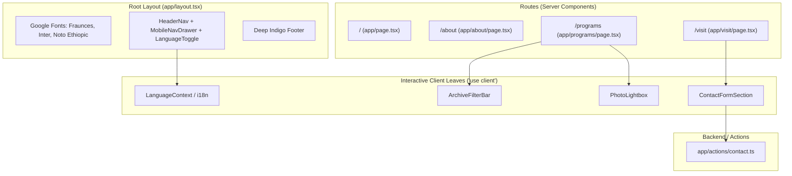

# Hiwot Birhan Summit Branch Website Rework Implementation Plan

> **For agentic workers:** REQUIRED SUB-SKILL: Use superpowers:subagent-driven-development to implement this plan task-by-task. Steps use checkbox (`- [ ]`) syntax for tracking.

**Goal:** Completely rework the Hiwot Birhan Summit branch church website from a legacy monolithic single-page site into a clean, componentized, multi-page Next.js App Router application with Tailwind CSS, shadcn/ui, and bilingual (English/Amharic) support.

**Architecture:** A Server-First App Router architecture featuring 4 dedicated routes (`/`, `/about`, `/programs`, `/visit`) rendered as Server Components with shared layout, persistent header/footer, and localized `"use client"` micro-components for interactivity (mobile navigation drawer, language switch, archive filtering, photo lightbox, and contact form). Data is separated into structured TypeScript models, and styling is driven by custom Tailwind v4 theme variables matching the brand guidelines.

**Architecture Diagram:**



**Tech Stack:**
- Next.js 16 (App Router, Server Components, Server Actions)
- React 19
- Tailwind CSS v4
- shadcn/ui primitives (`Button`, `Input`, `Textarea`, `Select`, `Dialog`, `Badge`, `Card`, `Tabs`)
- Google Fonts (`Fraunces`, `Inter`, `Noto Serif Ethiopic`, `Noto Sans Ethiopic`) via `next/font/google`
- Lucide React icons
- Zod schema validation

## Global Constraints
- Maximum file length: no page or component file may exceed 150-200 lines.
- Zero raw 1,400-line CSS bloat in `globals.css` — use Tailwind utility classes and theme tokens.
- Server Components by default; `"use client"` restricted strictly to interactive leaf components.
- Pill geometry (`rounded-full`) for buttons/badges; soft radius (`rounded-2xl`) for cards/inputs.
- Exact brand colors: Summit Indigo (`#3A33A0`), Deep Indigo (`#1B1763`), Soft Indigo (`#6B64D6`), Radiance Gold (`#C8993A`), Paper (`#FAF9F6`), Ink (`#14122B`), Mist (`#ECEBF8`).
- Ethiopic line-height 1.35x-1.7x; no faux italics on Amharic text.

---

### Task 1: Theme, Design Tokens, Fonts & Styles Setup

**Files:**
- Modify: `app/globals.css`
- Modify: `app/layout.tsx`
- Test: Build check (`pnpm next build` / `tsc --noEmit`)

**Interfaces:**
- Consumes: Tailwind CSS v4, `next/font/google`
- Produces: Global CSS variables (`--color-primary`, `--color-primary-deep`, `--color-accent`, etc.) and CSS font variables (`--font-fraunces`, `--font-inter`, `--font-noto-serif-ethiopic`, `--font-noto-sans-ethiopic`).

- [ ] **Step 1: Replace legacy `app/globals.css` with clean Tailwind tokens**

```css
@import "tailwindcss";
@import "tw-animate-css";

@custom-variant dark (&:is(.dark *));

@theme inline {
  --color-primary: #3A33A0;
  --color-primary-deep: #1B1763;
  --color-primary-soft: #6B64D6;
  --color-accent: #C8993A;
  --color-background: #FAF9F6;
  --color-surface: #FFFFFF;
  --color-tint: #ECEBF8;
  --color-foreground: #14122B;
  --color-muted-foreground: #5B5878;
  --color-border: #ECEBF8;
  --color-input: #ECEBF8;
  --color-ring: #3A33A0;
  --radius-pill: 9999px;
  --radius-card: 1rem;
}

:root {
  --background: #FAF9F6;
  --foreground: #14122B;
  --primary: #3A33A0;
  --primary-deep: #1B1763;
  --primary-soft: #6B64D6;
  --accent: #C8993A;
  --tint: #ECEBF8;
  --surface: #FFFFFF;
  --border: #ECEBF8;
  --input: #ECEBF8;
  --ring: #3A33A0;
  --radius: 1rem;
}

.dark {
  --background: #14122B;
  --foreground: #FAF9F6;
  --primary: #8F89EA;
  --primary-deep: #1B1763;
  --primary-soft: #6B64D6;
  --accent: #C8993A;
  --tint: #231F6E;
  --surface: #1B1763;
  --border: #231F6E;
  --input: #231F6E;
  --ring: #8F89EA;
}

* {
  box-sizing: border-box;
}

html {
  scroll-behavior: smooth;
  background-color: var(--background);
}

body {
  margin: 0;
  background-color: var(--background);
  color: var(--foreground);
  font-family: var(--font-inter), sans-serif;
}

.font-display {
  font-family: var(--font-fraunces), serif;
}

html:lang(am) body {
  font-family: var(--font-noto-sans-ethiopic), var(--font-inter), sans-serif;
  line-height: 1.65;
}

html:lang(am) .font-display,
html:lang(am) h1,
html:lang(am) h2,
html:lang(am) h3 {
  font-family: var(--font-noto-serif-ethiopic), var(--font-fraunces), serif;
  font-style: normal !important;
  line-height: 1.35;
}
```

- [ ] **Step 2: Update `app/layout.tsx` with Google Fonts & metadata**

```tsx
import type { Metadata, Viewport } from "next";
import { Fraunces, Inter, Noto_Serif_Ethiopic, Noto_Sans_Ethiopic } from "next/font/google";
import "./globals.css";

const fraunces = Fraunces({
  subsets: ["latin"],
  variable: "--font-fraunces",
  display: "swap",
});

const inter = Inter({
  subsets: ["latin"],
  variable: "--font-inter",
  display: "swap",
});

const notoSerifEthiopic = Noto_Serif_Ethiopic({
  subsets: ["ethiopic"],
  variable: "--font-noto-serif-ethiopic",
  display: "swap",
  weight: ["400", "600", "700"],
});

const notoSansEthiopic = Noto_Sans_Ethiopic({
  subsets: ["ethiopic"],
  variable: "--font-noto-sans-ethiopic",
  display: "swap",
  weight: ["400", "500", "600", "700"],
});

export const metadata: Metadata = {
  title: "Hiwot Birhan Addis Ababa Summit Branch",
  description: "Proclaiming the light of life in Addis Ababa. There is room for you here.",
  icons: {
    icon: "/docs/SVG/logo-only-indigo-no-background.svg",
  },
};

export const viewport: Viewport = {
  colorScheme: "light dark",
  themeColor: "#3A33A0",
  width: "device-width",
  initialScale: 1,
};

export default function RootLayout({
  children,
}: Readonly<{
  children: React.ReactNode;
}>) {
  return (
    <html
      lang="en"
      className={`${fraunces.variable} ${inter.variable} ${notoSerifEthiopic.variable} ${notoSansEthiopic.variable}`}
      suppressHydrationWarning
    >
      <body className="min-h-screen bg-[var(--background)] text-[var(--foreground)] antialiased font-sans selection:bg-[#3A33A0] selection:text-white">
        {children}
      </body>
    </html>
  );
}
```

- [ ] **Step 3: Run TypeScript compiler check**

Run: `pnpm exec tsc --noEmit`
Expected: PASS with 0 errors.

- [ ] **Step 4: Commit**

```bash
git add app/globals.css app/layout.tsx
git commit -m "chore: setup theme tokens, brand colors and google fonts"
```

---

### Task 2: Data Models & Bilingual (i18n) Setup

**Files:**
- Create: `lib/data/schedules.ts`
- Create: `lib/data/values.ts`
- Create: `lib/data/faith.ts`
- Create: `lib/data/leadership.ts`
- Create: `lib/data/programs.ts`
- Create: `lib/data/ministries.ts`
- Create: `messages/en.json`
- Create: `messages/am.json`
- Create: `lib/context/language-context.tsx`
- Test: `tsc --noEmit`

**Interfaces:**
- Produces: Typed content models and `LanguageProvider` with `useLanguage()` hook.

- [ ] **Step 1: Create typed datasets for schedules, values, faith, leadership, programs, and ministries**

Implement static datasets in `lib/data/` representing church content from PRD and HTML mockups.

- [ ] **Step 2: Create dictionary message files `messages/en.json` and `messages/am.json`**

Include complete strings for navigation, hero, service times, section headings, and form labels in both English and Amharic.

- [ ] **Step 3: Implement `lib/context/language-context.tsx` with locale persistence**

Provide `lang` ('en' | 'am'), `toggleLang()`, and `t` dictionary accessor with `localStorage` and `document.documentElement.lang` sync.

- [ ] **Step 4: Run typecheck**

Run: `pnpm exec tsc --noEmit`
Expected: PASS with 0 errors.

- [ ] **Step 5: Commit**

```bash
git add lib/data/ messages/ lib/context/
git commit -m "feat: add typed content datasets and bilingual i18n dictionary"
```

---

### Task 3: Reusable shadcn Primitives & Navigation Components

**Files:**
- Create: `components/ui/button.tsx`
- Create: `components/ui/badge.tsx`
- Create: `components/ui/card.tsx`
- Create: `components/ui/input.tsx`
- Create: `components/ui/textarea.tsx`
- Create: `components/ui/dialog.tsx`
- Create: `components/ui/lightbox.tsx`
- Create: `components/navigation/logo.tsx`
- Create: `components/navigation/header-nav.tsx`
- Create: `components/navigation/mobile-nav.tsx`
- Create: `components/navigation/language-toggle.tsx`
- Create: `components/navigation/footer.tsx`
- Modify: `app/layout.tsx` (wrap with `LanguageProvider`, include `HeaderNav` and `Footer`)
- Test: Verify header, footer, and navigation render in browser

- [ ] **Step 1: Standardize shadcn UI components (`Button`, `Badge`, `Card`, `Input`, `Textarea`, `Dialog`, `Lightbox`)**

Ensure `Button` supports variants: `primary` (Summit Indigo), `secondary` (Indigo outline), `on-dark` (White fill), `on-dark-outline` (White outline), all pill-shaped (`rounded-full`).

- [ ] **Step 2: Build `LogoLockup` component in `components/navigation/logo.tsx`**

Renders the SVG logo mark and Fraunces wordmark:
```tsx
import Link from "next/link";

export function LogoLockup({ reversed = false }: { reversed?: boolean }) {
  return (
    <Link href="/" className="flex items-center gap-3 group focus:outline-none">
      <div className={`w-10 h-10 rounded-full flex items-center justify-center border ${reversed ? "border-white/30 bg-white/10" : "border-[#3A33A0]/20 bg-[#ECEBF8]"}`}>
        <svg viewBox="0 0 100 100" className={`w-6 h-6 ${reversed ? "text-white" : "text-[#3A33A0]"}`} fill="currentColor">
          <circle cx="50" cy="50" r="46" fill="none" stroke="currentColor" strokeWidth="4" />
          <path d="M50 20 V80 M32 40 H68" stroke="currentColor" strokeWidth="5" strokeLinecap="round" />
        </svg>
      </div>
      <div className="flex flex-col">
        <span className={`font-display font-bold text-lg leading-tight tracking-tight ${reversed ? "text-white" : "text-[#14122B] group-hover:text-[#3A33A0]"} transition-colors`}>
          Hiwot Birhan
        </span>
        <span className={`text-xs font-medium ${reversed ? "text-white/70" : "text-[#5B5878]"}`}>
          Summit Branch
        </span>
      </div>
    </Link>
  );
}
```

- [ ] **Step 3: Build `HeaderNav`, `MobileNav`, `LanguageToggle`, and `Footer`**

Include active route highlighting, smooth mobile drawer opening, and complete footer sitemap.

- [ ] **Step 4: Connect into `app/layout.tsx`**

- [ ] **Step 5: Verify build & commit**

```bash
git add components/ui/ components/navigation/ app/layout.tsx
git commit -m "feat: implement brand navigation shell, shadcn components and footer"
```

---

### Task 4: Server Action & Form Primitives (`app/actions/contact.ts`)

**Files:**
- Create: `app/actions/contact.ts`
- Create: `components/visit/contact-form.tsx`
- Test: Verify Server Action validation and form states

**Interfaces:**
- Produces: `submitContactForm(prevState, formData)` Server Action with Zod validation.

- [ ] **Step 1: Write `app/actions/contact.ts` with Zod schema validation**

```typescript
"use server";

import { z } from "zod";

const ContactSchema = z.object({
  fullName: z.string().min(2, "Name must be at least 2 characters"),
  contactInfo: z.string().min(5, "Please enter a valid phone number or email"),
  category: z.enum(["visit", "prayer", "pastoral", "general"]),
  message: z.string().min(10, "Message must be at least 10 characters"),
  isPrayerRequest: z.boolean().optional(),
});

export type ContactState = {
  success?: boolean;
  message?: string;
  errors?: Record<string, string[]>;
};

export async function submitContactForm(
  _prevState: ContactState,
  formData: FormData
): Promise<ContactState> {
  const rawData = {
    fullName: formData.get("fullName"),
    contactInfo: formData.get("contactInfo"),
    category: formData.get("category"),
    message: formData.get("message"),
    isPrayerRequest: formData.get("isPrayerRequest") === "true",
  };

  const parsed = ContactSchema.safeParse(rawData);
  if (!parsed.success) {
    return {
      success: false,
      message: "Please correct the errors in the form.",
      errors: parsed.error.flatten().fieldErrors,
    };
  }

  // Simulate storing/dispatching message
  console.log("Contact submission received:", parsed.data);

  return {
    success: true,
    message: "Thank you. We received your message and will be in touch.",
  };
}
```

- [ ] **Step 2: Build `ContactForm` component with `useActionState`**

Include accessible error displays, pending state with spinner, and success confirmation banner.

- [ ] **Step 3: Run type check & commit**

```bash
git add app/actions/contact.ts components/visit/contact-form.tsx
git commit -m "feat: add contact form Server Action and interactive form component"
```

---

### Task 5: Route `/` — Home Page Refactoring

**Files:**
- Create: `components/home/hero-section.tsx`
- Create: `components/home/service-summary.tsx`
- Create: `components/home/about-intro.tsx`
- Create: `components/home/ministries-preview.tsx`
- Create: `components/home/featured-event.tsx`
- Create: `components/home/sermon-preview.tsx`
- Create: `components/home/gallery-preview.tsx`
- Create: `components/home/visit-cta.tsx`
- Modify: `app/page.tsx`
- Test: Verify home screen matches `docs/screens/home_hiwot_birhan_summit_branch/screen.png`

- [ ] **Step 1: Implement `HeroSection` and `ServiceSummary`**

Render the indigo gradient hero, gold rule, headline, schedule cards with `-mt-6 z-20` overlap, and service badges.

- [ ] **Step 2: Implement `AboutIntro`, `MinistriesPreview`, `FeaturedEvent`, and `SermonPreview`**

Replicate the exact visual layout from `docs/screens/home_hiwot_birhan_summit_branch/code.html` using Tailwind classes and shadcn buttons.

- [ ] **Step 3: Implement `GalleryPreview` and `VisitCta`**

4-column responsive grid with hover zooms and bottom callout to `/visit`.

- [ ] **Step 4: Refactor `app/page.tsx`**

```tsx
import { HeroSection } from "@/components/home/hero-section";
import { ServiceSummary } from "@/components/home/service-summary";
import { AboutIntro } from "@/components/home/about-intro";
import { MinistriesPreview } from "@/components/home/ministries-preview";
import { FeaturedEvent } from "@/components/home/featured-event";
import { SermonPreview } from "@/components/home/sermon-preview";
import { GalleryPreview } from "@/components/home/gallery-preview";
import { VisitCta } from "@/components/home/visit-cta";

export default function HomePage() {
  return (
    <main className="flex flex-col min-h-screen">
      <HeroSection />
      <ServiceSummary />
      <AboutIntro />
      <MinistriesPreview />
      <FeaturedEvent />
      <SermonPreview />
      <GalleryPreview />
      <VisitCta />
    </main>
  );
}
```

- [ ] **Step 5: Verify build & commit**

```bash
git add components/home/ app/page.tsx
git commit -m "feat: refactor home page into modular server-first components"
```

---

### Task 6: Route `/about` — Our Story & Values Page

**Files:**
- Create: `components/about/story-hero.tsx`
- Create: `components/about/scripture-banner.tsx`
- Create: `components/about/founding-timeline.tsx`
- Create: `components/about/values-pillars.tsx`
- Create: `components/about/faith-accordion.tsx`
- Create: `components/about/leadership-grid.tsx`
- Create: `components/about/about-visit-cta.tsx`
- Create: `app/about/page.tsx`
- Test: Verify about page matches `docs/screens/our_story_values_hiwot_birhan_summit/screen.png`

- [ ] **Step 1: Implement `StoryHero`, `ScriptureBanner`, and `FoundingTimeline`**

Milestone cards with year pills, connection line, and origin story of the Summit branch.

- [ ] **Step 2: Implement `ValuesPillars` (5 Guiding Pillars) and `FaithAccordion`**

5 distinct cards with icons and descriptions, plus the statement of faith cards.

- [ ] **Step 3: Implement `LeadershipGrid` and `AboutVisitCta`**

Circular portraits, leader titles, shepherd bios, and visit prompt.

- [ ] **Step 4: Compose `app/about/page.tsx`** (< 60 lines)

- [ ] **Step 5: Verify build & commit**

```bash
git add components/about/ app/about/page.tsx
git commit -m "feat: implement Our Story and Values page with timeline and leadership"
```

---

### Task 7: Route `/programs` — Programs & Past Archive Page

**Files:**
- Create: `components/programs/programs-hero.tsx`
- Create: `components/programs/upcoming-section.tsx`
- Create: `components/programs/upcoming-card.tsx`
- Create: `components/programs/archive-filter-bar.tsx`
- Create: `components/programs/past-programs-grid.tsx`
- Create: `components/programs/archival-photo-grid.tsx`
- Create: `components/programs/community-story-cta.tsx`
- Create: `app/programs/page.tsx`
- Test: Verify programs page matches `docs/screens/programs_past_archive_hiwot_birhan_summit/screen.png`

- [ ] **Step 1: Implement `ProgramsHero` and `UpcomingSection`**

Upcoming assemblies and camps with registration dialog trigger.

- [ ] **Step 2: Implement `ArchiveFilterBar` (`"use client"`) and `PastProgramsGrid`**

Interactive filter bar for category (Camp, Awana, Conference) and year (2024, 2023, 2022) with retrospective program cards.

- [ ] **Step 3: Implement `ArchivalPhotoGrid` with `PhotoLightbox` and `CommunityStoryCta`**

High-res photo grid with click-to-enlarge modal and testimonial submission prompt.

- [ ] **Step 4: Compose `app/programs/page.tsx`** (< 65 lines)

- [ ] **Step 5: Verify build & commit**

```bash
git add components/programs/ app/programs/page.tsx
git commit -m "feat: implement programs and past archive page with filters and lightbox"
```

---

### Task 8: Route `/visit` — Visit, Directions & Contact Page

**Files:**
- Create: `components/visit/visit-hero.tsx`
- Create: `components/visit/time-explainer-callout.tsx`
- Create: `components/visit/weekly-schedule-grid.tsx`
- Create: `components/visit/what-to-expect.tsx`
- Create: `components/visit/transit-directions.tsx`
- Create: `components/visit/contact-channels.tsx`
- Create: `app/visit/page.tsx`
- Test: Verify visit page matches `docs/screens/visit_contact_hiwot_birhan_summit/screen.png`

- [ ] **Step 1: Implement `VisitHero` and `TimeExplainerCallout`**

Clear comparison between Ethiopian Local Time (ቀን / ማታ) and East Africa Time (EAT).

- [ ] **Step 2: Implement `WeeklyScheduleGrid` and `WhatToExpect`**

Schedule breakdown for Sunday, Thursday, Saturday, Awana; 5 newcomer cards.

- [ ] **Step 3: Implement `TransitDirections`, `ContactChannels`, and integrate `ContactForm`**

Landmark directions, map link, tap-to-call numbers, Telegram link, and form.

- [ ] **Step 4: Compose `app/visit/page.tsx`** (< 65 lines)

- [ ] **Step 5: Verify build & commit**

```bash
git add components/visit/ app/visit/page.tsx
git commit -m "feat: implement visit and contact page with time explainer and transit guide"
```

---

### Task 9: Clean Up Legacy Files & End-to-End Verification

**Files:**
- Remove/replace obsolete v0 components in `components/landing/` and legacy `components/church-home.tsx`
- Test: `tsc --noEmit`, `pnpm build`, responsive audit

- [ ] **Step 1: Delete or archive obsolete v0 landing components**

Remove legacy unused files that relied on the old 1,400-line global styles.

- [ ] **Step 2: Run full TypeScript compilation**

Run: `pnpm exec tsc --noEmit`
Expected: 0 errors.

- [ ] **Step 3: Run Next.js production build**

Run: `pnpm run build`
Expected: Production build successful with static generation of `/`, `/about`, `/programs`, `/visit`.

- [ ] **Step 4: Verify line count constraint**

Check all component and page files: verify no file exceeds 200 lines.

- [ ] **Step 5: Commit and tag**

```bash
git add -A
git commit -m "chore: clean up obsolete v0 components and verify production build"
```
