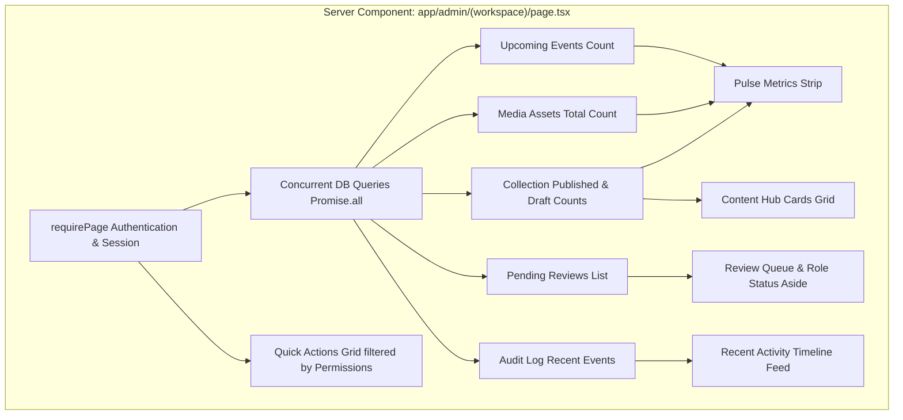

# Admin Overview & Quick Actions Implementation Plan

> **For agentic workers:** REQUIRED SUB-SKILL: Use superpowers:subagent-driven-development to implement this plan task-by-task. Steps use checkbox (`- [ ]`) syntax for tracking.

**Goal:** Transform the Admin Overview page (`/admin`) into a high-utility dashboard featuring a prominent permission-aware Quick Actions grid, live health pulse metrics, a structured Content Hub, review queue, and recent activity feed.

**Architecture:** The page is a React Server Component (`app/admin/(workspace)/page.tsx`) that gathers metrics, pending reviews, media counts, and audit logs via concurrent Drizzle ORM queries in `Promise.all`. Clean semantic CSS in `app/admin/admin.css` provides responsive layout and interactive feedback, strictly adhering to `DESIGN.md` and `impeccable` guidelines.

**Architecture Diagram:**



**Tech Stack:** Next.js 16 (App Router / React Server Components), Drizzle ORM, Lucide React, semantic CSS (`admin.css`).

## Global Constraints

- Must strictly follow `DESIGN.md`: Summit Indigo (`#4C24B8`), warm Paper (`#FAF9FE`), clean White (`#FFFFFF`), Mist borders (`#e7e4ee`), Radiance Gold (`#C8993A`) ≤ 5%.
- Must adhere to `impeccable` craft floor: No AI slop (no gradient text, no glassmorphism/blurs, no hero-metric big-number templates, no emoji icons, real Lucide icon strokes, contrast ≥ 4.5:1).
- Quick Actions must be strictly permission-gated according to `staff.permissions`.
- Zero client bundle overhead for data fetching (RSC).
- All existing tests (`pnpm test:cms`, `pnpm test:media`) must continue passing with zero regressions.

---

### Task 1: Overview Helper & Permission-Gated Quick Actions Unit Test

**Files:**
- Create: `lib/admin/overview.ts`
- Create: `tests/admin-overview.test.ts`

**Interfaces:**
- `getQuickActions(permissions: string[]): QuickActionItem[]` returns available 1-click action cards.
- `QuickActionItem`: `{ id: string; title: string; subtitle: string; href: string; icon: LucideIcon; permission: string; }`

- [ ] **Step 1: Write the failing test for quick action filtering and pulse metrics calculation**

```ts
import test from "node:test";
import assert from "node:assert/strict";
import { getQuickActions, calculatePulseMetrics } from "../lib/admin/overview";

test("getQuickActions returns all actions for administrators with full permissions", () => {
  const allPermissions = [
    "events.write",
    "sermons.write",
    "schedules.write",
    "leaders.write",
    "recaps.write",
    "media.write",
  ];
  const actions = getQuickActions(allPermissions);
  assert.equal(actions.length, 6);
  assert.deepEqual(actions.map(a => a.id), [
    "new-event",
    "new-sermon",
    "new-schedule",
    "new-leader",
    "new-recap",
    "upload-photo",
  ]);
});

test("getQuickActions filters out actions when staff lacks permission", () => {
  const editorPermissions = ["events.write", "media.write"];
  const actions = getQuickActions(editorPermissions);
  assert.equal(actions.length, 2);
  assert.deepEqual(actions.map(a => a.id), ["new-event", "upload-photo"]);
});

test("calculatePulseMetrics computes correct totals from db aggregations", () => {
  const counts = [
    { kind: "events", total: 10, published: 8 },
    { kind: "sermons", total: 5, published: 5 },
    { kind: "schedules", total: 4, published: 4 },
  ];
  const metrics = calculatePulseMetrics({
    counts,
    mediaCount: 25,
    upcomingEventsCount: 3,
    reviewCount: 2,
  });
  assert.equal(metrics.publishedTotal, 17);
  assert.equal(metrics.needsAttention, 2);
  assert.equal(metrics.mediaTotal, 25);
  assert.equal(metrics.upcomingEvents, 3);
});
```

- [ ] **Step 2: Run test to confirm it fails**

Run: `pnpm exec tsx --test tests/admin-overview.test.ts`
Confirm: Fails due to missing module `../lib/admin/overview`.

- [ ] **Step 3: Implement `lib/admin/overview.ts`**

Implement `getQuickActions` and `calculatePulseMetrics`.

- [ ] **Step 4: Run test to confirm it passes**

Run: `pnpm exec tsx --test tests/admin-overview.test.ts`
Confirm: All tests pass.

- [ ] **Step 5: Commit changes**

Commit: `git add lib/admin/overview.ts tests/admin-overview.test.ts; git commit -m "feat(admin): add overview metrics helpers and permission-gated quick actions with tests"`

---

### Task 2: Stylesheet Enhancements for Pulse Stats, Quick Actions Grid, and Content Hub

**Files:**
- Modify: `app/admin/admin.css`

**Interfaces:**
- CSS classes:
  - `.admin-pulse-bar`, `.admin-pulse-chip`, `.admin-pulse-chip-value`, `.admin-pulse-chip-label`
  - `.admin-quick-actions-section`, `.admin-quick-actions-grid`, `.admin-quick-action-card`, `.admin-quick-action-icon`, `.admin-quick-action-title`, `.admin-quick-action-desc`
  - `.admin-content-hub-grid`, `.admin-content-hub-card`, `.admin-hub-card-header`, `.admin-hub-card-stats`
  - Responsive media query updates for tablet (1024px) and mobile (640px).

- [ ] **Step 1: Add semantic CSS styles for Pulse Bar, Quick Actions Grid, and Content Hub**
- [ ] **Step 2: Verify responsive behavior and ensure zero CSS syntax errors**
- [ ] **Step 3: Commit stylesheet updates**

Commit: `git add app/admin/admin.css; git commit -m "style(admin): add styles for pulse metrics, quick actions grid, and content hub"`

---

### Task 3: Refactor the Overview Server Component

**Files:**
- Modify: `app/admin/(workspace)/page.tsx`

**Interfaces:**
- Consumes:
  - `requirePage()` from `@/lib/cms/access`
  - `getQuickActions`, `calculatePulseMetrics` from `@/lib/admin/overview`
  - Database queries on `content`, `media`, and `auditLog`
- Produces:
  - Rendered React Server Component dashboard with Header, Pulse bar, Quick Actions grid, two-column split (Content Hub + Review queue / Access status), and Recent activity timeline.

- [ ] **Step 1: Update concurrent queries in `app/admin/(workspace)/page.tsx` to include media total and upcoming events count**
- [ ] **Step 2: Render personalized greeting with role badge and Addis Ababa date**
- [ ] **Step 3: Render Pulse Metrics strip**
- [ ] **Step 4: Render Quick Actions Grid**
- [ ] **Step 5: Render Content Hub cards and Ready for Review aside**
- [ ] **Step 6: Render Recent Activity feed**
- [ ] **Step 7: Run TypeScript verification (`pnpm exec tsc --noEmit`)**
- [ ] **Step 8: Commit changes**

Commit: `git add app/admin/(workspace)/page.tsx; git commit -m "feat(admin): refactor overview dashboard with quick actions and pulse metrics"`

---

### Task 4: End-to-End Verification & Quality Pass

**Files:**
- Test: All suites across CMS, media, pagination, and overview.

- [ ] **Step 1: Run all unit and integration tests**
  - `pnpm exec tsx --test tests/admin-overview.test.ts`
  - `pnpm test:cms`
  - `pnpm test:media`
  - `pnpm exec tsx --test tests/media-pagination.test.ts`
- [ ] **Step 2: Run TypeScript compile verification**
  - `pnpm exec tsc --noEmit`
- [ ] **Step 3: Run production build**
  - `pnpm build`
- [ ] **Step 4: Push to origin**
  - `git push origin fix/admin-image-interactinos`
